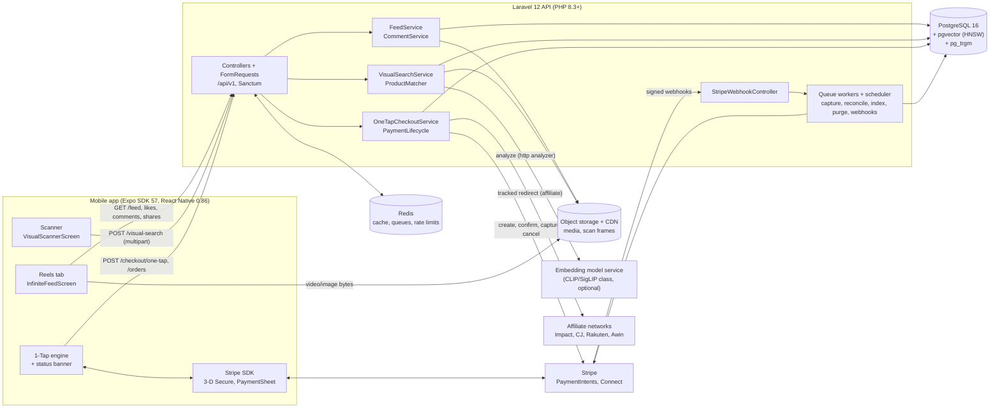
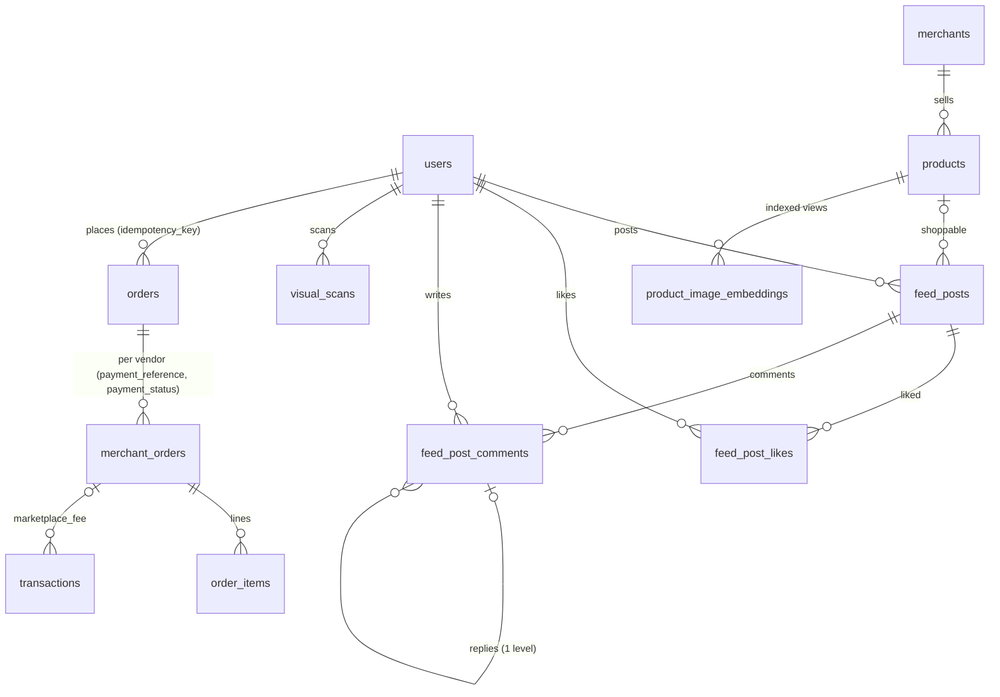
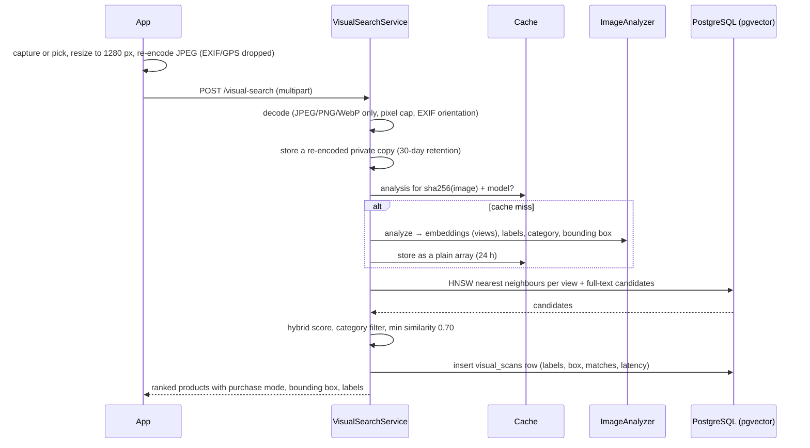
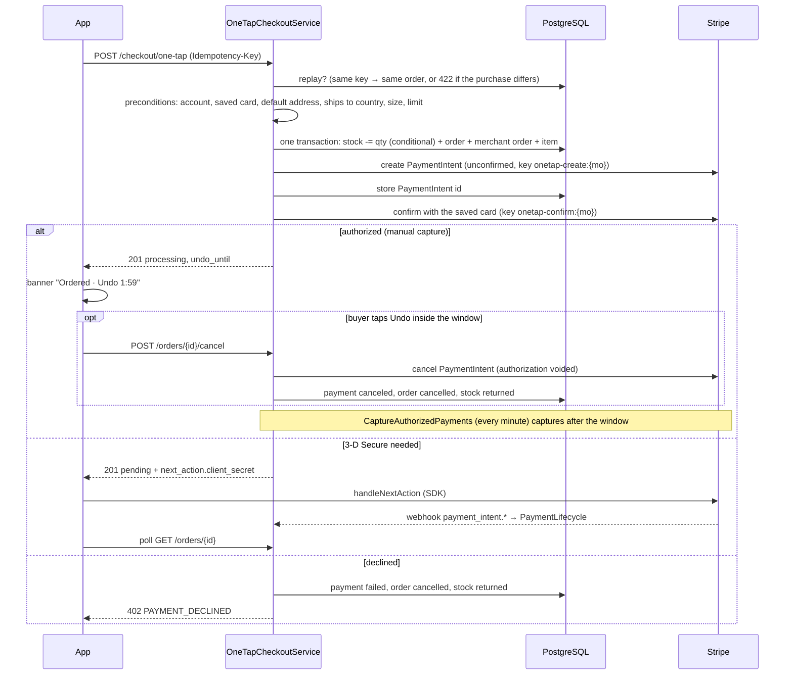

# Social discovery and 1-Tap commerce: architecture

Release 2 of the platform: a Reels-style video feed, AI visual search ("scan anything, buy it") and
1-Tap checkout. This document is the system design, the map from the original specification to the code,
and the operating notes. It builds on release 1 (schema, ledger, rewards; see `docs/erd.md` and the
README).

Contents

1. [Product loop and design principles](#1-product-loop-and-design-principles)
2. [System overview](#2-system-overview)
3. [From the specification to the code](#3-from-the-specification-to-the-code)
4. [Data model](#4-data-model)
5. [API reference](#5-api-reference)
6. [Flows](#6-flows)
7. [Mobile app](#7-mobile-app)
8. [Visual search engine](#8-visual-search-engine)
9. [Scaling to millions of users](#9-scaling-to-millions-of-users)
10. [Security, privacy and compliance](#10-security-privacy-and-compliance)
11. [Configuration](#11-configuration)
12. [Verification](#12-verification)
13. [Known gaps and next steps](#13-known-gaps-and-next-steps)

---

## 1. Product loop and design principles

**Watch, scan, buy.** People scroll short videos and photos. Anything they see (in a reel, in the street,
in a screenshot from another app) can be scanned. Every result and every shoppable reel carries a buy
button that completes a purchase in one tap.

| Principle | What it means in the code |
|---|---|
| The server owns money and stock | `POST /checkout/one-tap` takes a product, an optional size, a quantity, and an optional `expected_total_minor` equal to the total the card showed. The server recomputes the landed total and returns `409 PRICE_CHANGED` when they differ. Cards stay in Stripe. |
| Every purchase is idempotent | One `Idempotency-Key` per tap. A retried or doubled tap returns the order the first one created. The key is bound to its purchase: the same key with a different product, size or quantity is refused (`422 IDEMPOTENCY_KEY_REUSED`). Every Stripe write that can move money carries an idempotency key derived from our own ids. |
| A tap is reversible for a short time | The tap only authorizes the card. During the undo window (default 120 s) the buyer can cancel for free: the authorization is voided, nothing is charged, the stock goes back. A scheduled job captures after the window. |
| Optimistic only where it is harmless | Likes are instant and corrected by the server's count. Purchases, comments and shares wait for the server. |
| The database enforces the invariants | Counters, comment depth, the social opt-in, media shape, slugs, ledger references and erasure are triggers and constraints, each with a test proving the database (not only PHP) rejects the bad state. |
| Private by default | Posting needs the social-feed opt-in. Frames scanned for search are private, stored without EXIF/GPS and deleted after 30 days. Videos lose their location atoms on upload. |
| Card data never reaches us | Cards, Apple Pay and Google Pay are saved in Stripe's PaymentSheet. We keep a Customer id, a `pm_` id and a display summary ("Visa ···· 4242"). |
| One state machine for payments | `PaymentLifecycle` is the only writer of payment states, under a row lock, with `PaymentStatus::canMoveTo()` deciding legal moves. The tap, the undo, the capture job, the reconciler and the webhooks all go through it. |
| Fast paths do no work twice | The analysis of a scanned image is cached by its hash; the For You ranking head is shared across viewers for 30 s; videos are cached on the device and the next reel is pre-buffered. |

## 2. System overview



| Component | Responsibility | Code |
|---|---|---|
| Feed | Cursor-paginated For You / Following, media posts, likes, comments, shares | `app/Services/Feed`, `FeedController`, `FeedCommentController` |
| Media | Video validation and remux (ffprobe/ffmpeg), image re-encode | `app/Services/Media` |
| Visual search | Decode and sanitize the frame, analyze (cached), hybrid retrieval, scan log | `app/Services/VisualSearch`, `VisualSearchController` |
| Catalog index | Embeds product images per analyzer model, one row per view | `IndexProductImages` job, `catalog:index-images` command |
| 1-Tap checkout | Preconditions, atomic stock reservation, PaymentIntent, undo, capture | `app/Services/Checkout`, `CheckoutController`, `OrderController` |
| Payments | Stripe gateway behind an interface, saved cards, webhook handling | `app/Services/Payments`, `PaymentMethodController`, `StripeWebhookController` |
| Privacy | Media erasure; `anonymize_user()` extended to the new data | `app/Services/Privacy`, migration `000600` |
| Mobile | Reels, scanner, 1-Tap engine and banner, Stripe bridge, comments sheet | `mobile/src/features/{reels,scanner,one-tap,payments}` |

## 3. From the specification to the code

The specification described a standalone schema (`users`, `products`, `posts`, `scans`, `orders`,
`likes`, `comments`). The platform already had a hardened schema from release 1, so the specification was
mapped onto it with new migrations instead of parallel tables. Every difference and its reason:

### Tables and columns

| Specification | Built | Why |
|---|---|---|
| `users.id` bigint | UUID v7 (existing) | Release 1 keys are UUID v7: time-ordered, safe to expose, no enumeration. |
| `users.avatar_url` | existing `avatar_path` + `MediaUrl` | Store keys, not URLs: the CDN host can change without a data migration. |
| `users.bio`, `social_score`, `trend_hunter_level`, `settings` (JSONB) | Added as specified, with CHECKs (bio ≤ 500, level 1..100, settings must be an object) | |
| `users.stripe_customer_id` | existing | |
| `users.default_payment_method_id` | `stripe_default_payment_method_id` (`^pm_…`) + `default_payment_method_summary` (JSONB brand/last4/expiry/wallet) | The summary lets the buy card show "Visa ···· 4242" without calling Stripe. Both columns are set together or not at all (CHECK). |
| `users.default_shipping_address_id` | existing `shipping_addresses.is_default` | Release 1 already had addresses with one default per user (partial unique index), encrypted at rest. |
| `products` with `vendor_id`, `price` decimal | existing `products` with `merchant_id`, `price_minor` integer + `currency` | Money is integer minor units everywhere (release 1 rule). `vendor` = a `merchants` row with `integration_type = 'marketplace'` and a Stripe Connect account. |
| `products.category`, `sub_category` | `category` holds the dotted taxonomy (`electronics.tv.oled`); `category_root` and `sub_category` are GENERATED from it | One source of truth, indexed both ways. |
| `products.images` (JSON) | existing `image_urls` | |
| `products.stock_quantity` | Added; NULL = not stock-managed (affiliate products), CHECK ≥ 0 | Stock is decremented by one conditional `UPDATE … WHERE stock_quantity >= ?`, so two buyers can never take the last unit. |
| `products.slug`, `description`, `attributes` (JSONB), soft deletes | Added; slug backfilled and filled by a trigger (`<title>-<id tail>`) | |
| (search over the catalog) | `search_document` generated `tsvector` (title, category, attribute values, description) + GIN; trigram index on title | Feeds the text half of visual search. |
| `posts` | existing `feed_posts` with a new kind `'media'` | Release 1 posts (purchase, resale, drop) keep their rules; media posts add `media_type`, `media_path`, `thumbnail_path`, dimensions, duration, `tags`, `product_id`, counters and `rank_score`. Audiences stay `friends` / `public`. |
| `likes` | `feed_post_likes` (primary key post + user) | The key makes a double like impossible; a trigger keeps `likes_count` exact. |
| `comments` | `feed_post_comments` with one level of replies | DB triggers enforce the social opt-in and reply depth; a composite foreign key keeps a reply on its parent's post. |
| `scans` | `visual_scans` (status, frame path, hash, size, analyzer, detected category, labels, bounding box, matched product ids, top similarity, latency, purge time) | Scan history and analytics without keeping the image forever. |
| `orders` (flat, with `stripe_payment_intent_id`) | existing `orders` → `merchant_orders` (`payment_reference` = PaymentIntent id, `payment_status`, `application_fee_minor`, `capture_after`) → `order_items` | A cart can span vendors; refunds and payouts are per vendor. `orders.idempotency_key` is unique per user. |
| Order status `pending/processing/completed/cancelled/failed/refunded` | Derived in `OrderStatusResource` from the order and payment states | The specification's vocabulary for the app, without a second status column that could disagree with the first. |

### Behaviour

| Specification | Built | Why |
|---|---|---|
| "Capture payment" on tap | Authorize on tap, capture after the undo window (`ONE_TAP_UNDO_WINDOW`, 0 = immediate) | A one-tap button invites accidental purchases. Voiding an authorization is free and instant; a refund is neither. |
| Stripe PaymentIntent with the default card | PaymentIntent on the platform with `on_behalf_of` + `transfer_data.destination` = vendor's Connect account + `application_fee_amount` | The vendor is the settlement merchant (their name on the statement, their returns and tax), the platform keeps its fee. |
| (missing) 3-D Secure | `next_action` in the response; the app finishes it with Stripe's SDK; a webhook settles the order | SCA (PSD2) applies to many European card payments. |
| (missing) affiliate products | Same button, "Shop at {merchant}": the endpoint returns a tracked redirect (SubID per network) | Products sold by affiliate merchants cannot be charged in-app. |
| Expo AV for video | `expo-video` | Expo AV was removed from the SDK. |
| `FlatList` or FlashList | `FlatList` (Reanimated `Animated.FlatList`), `windowSize` 3 | FlashList recycles cells, which hands one native video player to another post and shows stale frames. |
| Base64 or multipart upload | Both. The app sends multipart on iOS/Android and base64 on the web | Multipart streams the file; base64 inflates it by a third. |

## 4. Data model

New migrations (each runs `up`, `down` and `up` again cleanly; nothing in `database/sql/*.sql` changed):

| Migration | Adds |
|---|---|
| `2026_10_12_000100_extend_users_for_social_discovery` | `bio`, `social_score`, `trend_hunter_level`, `settings`, saved payment method + summary |
| `2026_10_12_000200_extend_catalog_for_universal_commerce` | `pg_trgm`, `vector`; marketplace merchants (Connect account, `connect_charges_enabled`, `marketplace_fee_bps`); product slug, description, attributes, stock, soft delete, generated taxonomy and `search_document`; `product_image_embeddings` (`vector(512)`, HNSW cosine, one row per product image × model × view) |
| `2026_10_12_000300_extend_feed_for_media_and_engagement` | media posts, tags, counters, `rank_score` trigger and index; `feed_post_likes`; `feed_post_comments` with guard and counter triggers |
| `2026_10_12_000400_create_visual_scans` | `visual_scans` with purge and history indexes |
| `2026_10_12_000500_add_one_tap_checkout` | `orders.idempotency_key`; `merchant_orders` payment state, fee, `capture_after`; `transactions.merchant_order_id`; the `marketplace_fee` ledger type |
| `2026_10_12_000600_extend_user_erasure` | `anonymize_user()` also scrubs bio, settings, saved card, likes, scans and comment text, and refuses while a card payment is in flight |

Your migration `2026_10_08_000000_add_drop_stream_and_product_embedding_ref` runs before these and is
unchanged: `drops.stream_url` (optional reel) and `products.embedding_ref` (an id in an external vector
index). The built-in visual search neither reads nor writes `embedding_ref`; its vectors live in
`product_image_embeddings`. The whole chain, yours included, migrates, rolls back and re-applies cleanly.



**Ranking.** `rank_score = log10(max(1, likes + 2·comments + 3·shares)) + epoch_seconds / 45000`,
maintained by a trigger. Ten times the engagement equals about 12.5 hours of recency. The For You index
is `(rank_score DESC, id DESC) WHERE audience = 'public' AND deleted_at IS NULL`.

**Payment states.** `requires_action → authorized | captured | failed | canceled`,
`authorized → captured | failed | canceled`, `captured → partially_refunded | refunded`,
`partially_refunded → refunded`. Any other move is refused, so a late or out-of-order webhook can never
move a payment backwards.

## 5. API reference

All endpoints are under `/api/v1`, need a Sanctum bearer token (except the webhook) and answer JSON.
Resources are wrapped in `{ "data": … }`; cursor lists add `meta.next_cursor`. Money is
`{ amount_minor, currency, minor_unit }`. Errors are `{ message, code, errors?, meta? }`; the app chooses
its copy from `code`, never from `message`.

| Method and path | Purpose | Notes |
|---|---|---|
| `GET /feed?mode=for_you\|following&cursor=&limit=` | Feed page | 240/min. Keyset cursor (rank or time). `422 INVALID_CURSOR` → start over. |
| `POST /feed` (multipart) | Media post: `media`, `caption`, `audience`, `tags[]`, `product_id` | 20/hour. `403 SOCIAL_OPT_IN_REQUIRED`, `422 MEDIA_REJECTED`. |
| `DELETE /feed/{post}` | Delete own post | |
| `POST /feed/{post}/like`, `DELETE /feed/{post}/like` | Idempotent like / unlike → `{ liked, likes_count }` | 120/min |
| `POST /feed/{post}/share` `{ channel }` | Counts the share, returns `{ shares_count, url }` (`/s/{token}` for shoppable posts) | 30/min |
| `GET /feed/{post}/comments?parent_id=&cursor=` | Oldest first; `parent_id` lists replies | |
| `POST /feed/{post}/comments` `{ body, parent_id? }` | Comment or reply | 10/min. `403 SOCIAL_OPT_IN_REQUIRED`, `422 COMMENT_REJECTED` |
| `DELETE /comments/{comment}` | By author or post owner | |
| `POST /visual-search` | `image` (multipart) or `image_base64` (data URI), optional `category` | 12/min and 500/day. `422 IMAGE_REJECTED`, `503 VISUAL_SEARCH_UNAVAILABLE` |
| `GET /visual-search` | Last 30 scans (no images) | |
| `POST /checkout/one-tap` + `Idempotency-Key` | `{ product_id, variant_sku?, quantity? }` | 6/min and 30/hour. `201` new, `200` replay or affiliate redirect. See codes below. |
| `GET /orders/{order}` | Order status (own orders only) | |
| `POST /orders/{order}/cancel` | Undo inside the window; idempotent | `409 ORDER_NOT_CANCELLABLE` once captured |
| `GET /payment-methods/default` | `{ has_default, summary, publishable_key }` | |
| `POST /payment-methods/setup` | `{ setup_intent_client_secret, customer_id, ephemeral_key_secret, publishable_key }` for PaymentSheet | |
| `POST /payment-methods/confirm` `{ setup_intent_id }` | After PaymentSheet succeeds: verified with Stripe, made the default at once | `404 SETUP_NOT_FOUND` |
| `POST /webhooks/stripe` | Signature-verified, stored minimized, processed by a queued job | No auth; duplicates answer `200 { duplicate: true }` |

1-Tap error codes: `402 PAYMENT_DECLINED` (`meta.decline_code`), `403 ACCOUNT_RESTRICTED`,
`409 ONE_TAP_UNAVAILABLE | OUT_OF_STOCK | PAYMENT_METHOD_REQUIRED | SHIPPING_ADDRESS_REQUIRED | NOT_SHIPPABLE`,
`422 ONE_TAP_LIMIT | VARIANT_UNAVAILABLE | IDEMPOTENCY_KEY_REUSED`, `429 RATE_LIMITED`,
`503 PAYMENT_PROVIDER_UNAVAILABLE` (nothing was charged).

Example tap response (authorized, inside the undo window):

```json
{
  "data": {
    "mode": "native",
    "order": {
      "id": "01a12d3e-…",
      "status": "processing",
      "payment_status": "authorized",
      "failure_code": null,
      "undo_until": "2026-10-12T09:41:07.000Z",
      "total": { "amount_minor": 12900, "currency": "USD", "minor_unit": 2 },
      "item": { "product_id": "01a12d3e-…", "title": "Court Classic Leather Sneaker", "variant_sku": "CC-001-41", "size_label": "EU 41", "quantity": 1 },
      "placed_at": "2026-10-12T09:39:07.000Z"
    },
    "next_action": null,
    "replayed": false
  }
}
```

## 6. Flows

### 6.1 Feed

- **For You**: public media posts by `rank_score`. The ordered ids of the first pages are cached for
  30 seconds and shared by every viewer, then filtered per viewer (blocks, deleted posts), so a burst of
  app opens costs one ranking query. Later pages use the cursor `(rank_score, id)`; the cursor carries the
  exact text of the stored double so no row is skipped or repeated.
- **Following**: the viewer's own posts and accepted friends' posts (audiences `friends` and `public`),
  newest first, cursor `(created_at, id)`.
- Each post comes with its author, media URLs (CDN), the product card with its purchase mode, counters,
  and `viewer.liked`. Who else liked a post is never exposed.

### 6.2 Posting media

Videos (MP4 / QuickTime, up to 100 MB and 3 minutes) are probed with `ffprobe` (H.264 or HEVC only; the
server measures the duration, the client's value is ignored), remuxed with `ffmpeg` without re-encoding
(`-map_metadata -1` removes GPS location atoms, `+faststart` moves the index to the front so playback
starts before the download ends, the display rotation is kept), and a poster frame is extracted. Images
are re-encoded to JPEG (EXIF stripped, longest edge 2160). Files go to the media disk (S3/R2 behind a
CDN in production); the database stores keys only. A failed save deletes the files it wrote.

### 6.3 Visual search



### 6.4 1-Tap checkout



On capture, `PaymentLifecycle` creates the buyer's closet units and posts the platform fee to the ledger
(`marketplace_fee`: debit platform cash, credit platform revenue, keyed `marketplace-fee:{mo}`).
Failures release the stock and cancel the order. Refunds (from the `charge.refunded` webhook) refund the
order and return the closet units.

**Crash safety.** The PaymentIntent is created unconfirmed (nothing charged) and its id stored before
confirming; Stripe calls are idempotent by our ids. If the process dies between steps,
`ReconcileOneTapPayments` (every 5 minutes) cancels intents that were never confirmed, cancels 3-D Secure
steps abandoned for 30 minutes, and adopts the provider's state otherwise. It never charges late.

**Affiliate products.** The same endpoint records an `affiliate_clicks` row and returns the network deep
link with our SubID (Impact `subId1`, CJ `sid`, Rakuten `u1`, Awin `clickref`). The app opens it in an
in-app browser.

### 6.5 Saving a card

`POST /payment-methods/setup` creates the Stripe Customer once and a SetupIntent (`usage: on_session`,
metadata `purpose: one_tap`) per attempt, plus an ephemeral key. The app presents PaymentSheet (card,
Apple Pay, Google Pay). On success it sends only the SetupIntent id to `POST /payment-methods/confirm`;
the server retrieves the SetupIntent from Stripe, checks the customer and purpose, and makes the method
the default at once. The `setup_intent.succeeded` webhook does the same as a backstop. **Newest setup
wins**: the summary records the SetupIntent's creation time and a compare-and-set update refuses an older
one, so a late webhook for an old card can never replace a card saved after it.

### 6.6 Webhooks

Verify the signature on the raw body → store a minimized copy (an allowlist: no client secrets, no
shipping or billing details) with a unique event id (`createOrFirst`, safe inside a transaction) →
acknowledge → process in the `webhooks` queue → mark processed, ignored or failed. Handled:
`payment_intent.*`, `charge.refunded`, `account.updated` (Connect charges enabled),
`setup_intent.succeeded`, `payment_method.detached`.

## 7. Mobile app

```
app/(tabs)/reels.tsx                 Reels tab → InfiniteFeedScreen
app/scan.tsx                         Scanner (stack screen, slides up) → VisualScannerScreen
app/+native-intent.tsx               keeps 3-D Secure returns and share links from opening "unmatched route"
app/_layout.tsx                      + CommentsSheet, OneTapBanner, Stripe redirect hand-off
src/api/contracts.ts                 response types (mirror of the Laravel resources)
src/api/social-commerce.ts           one typed function per endpoint
src/features/reels/                  feed screen, reel page, video, action rail, comments sheet, cache helpers
src/features/scanner/                scanner screen, reticle (grid + radar sweep), results sheet, image prep
src/features/one-tap/                engine (state machine), store, buy card, banner, payment-method query
src/features/payments/               Stripe bridge: .native.ts (SDK) and .ts (web stub), publishable key
```

**State.** Server state is TanStack Query (`useInfiniteQuery` for the feed and comments). Likes are
optimistic and reconciled with the server's count; mutations of one kind run in one scope so the last tap
wins. UI state is Zustand: mute, the open comments sheet, and the 1-Tap purchases (module scope, so a
purchase continues while its reel scrolls away).

**Playback.** `expo-video` with `useCaching: true` (LRU disk cache, 1 GB default). The FlatList keeps the
pages above and below mounted (`windowSize` 3): their players are created, buffered and paused, so the
next swipe starts at once. Only the page on screen plays, and only while the tab is focused and the app
is in the foreground. Leaving a page rewinds it. Posters cover the view until the first frame renders.
Progress events (10 Hz) only for the playing page, written to a shared value (no React render). One tap
pauses; a double tap likes (gold heart burst at the finger); taps are classified in JS so they behave the
same on iOS, Android and the web.

**Scroll motion.** `useAnimatedScrollHandler` writes the offset to a shared value; each page fades and
drifts its overlays from it on the UI thread.

**1-Tap engine** (`one-tap-engine.ts`). States: submitting → (saving card) → (authenticating) →
confirming → authorized (undo) → completed | cancelled | failed. Rules: one `crypto.randomUUID()` key
per tap, reused for network retries and for any retry whose outcome is unknown; a new key only after a
definite end (declined, cancelled, authentication failed). Known "no saved card" opens PaymentSheet before
sending the tap. A failed 3-D Secure cancels the order at once (the reconciler would otherwise do it).
The banner (top of every screen) shows progress, the undo countdown and the one action that resolves a
failure.

**Scanner.** `expo-camera` preview with a grid, gold brackets and a radar sweep (Reanimated); the camera
session pauses whenever the preview is not needed (`active` on iOS, `pausePreview` on Android).
Shutter or Photos → resize to 1280 px and re-encode JPEG on the device (a 12 MP photo becomes
~150–300 KB; EXIF and GPS are dropped) → upload → results sheet over the frozen frame with the detected
box. Category chips re-run the search on the same prepared frame.

**Platform notes.** Web has no Stripe SDK: 3-D Secure and saving a card ask the person to use the mobile
app. `pointerEvents: 'box-none'` on overlays must come from `StyleSheet.create` (plus the prop on
Reanimated views) for react-native-web. Comments and results are in-tree sheets, not native modals, so
Stripe's sheets can present over them.

**Native build.** `expo-camera`, `expo-video`, `expo-image-manipulator`, `expo-crypto` and
`@stripe/stripe-react-native` are in Expo Go; Apple Pay needs a development build with the Stripe plugin's
`merchantIdentifier`.

## 8. Visual search engine

**Analyzer contract** (`Contracts/ImageAnalyzer`): `model(): string` and
`analyze(DecodedImage): ImageAnalysis` with an L2-normalized 512-d `embedding`, `views` (extra
embeddings of content crops), `labels` (`[{label, score}]`), a dotted `category`, `semantic` (true when
labels name objects) and a normalized `boundingBox`.

| Analyzer | Use | What it recognizes |
|---|---|---|
| `deterministic` (default) | Development, tests, and as a fallback | The same or near-identical image: product photos, screenshots, crops, reposts. Pure PHP (GD): HSV colour histogram, colour layout, gradient orientations (HOG), a 12×12 thumbnail, texture (LBP) and aspect descriptors, on the full frame and up to two content crops. |
| `http` | Production | Real objects from any angle, via your CLIP/SigLIP-class model service. Request: multipart image. Response: `{ model, embedding[512], labels, category, bounding_box }`. |

**Ranking.** `score = 0.75 · visual + 0.15 · text + 0.10 · category`. Visual is the best cosine
similarity over (query view × catalog view) pairs from the HNSW index (`ef_search` 200, 200 candidates);
text is `ts_rank_cd` of the model's labels against `search_document` (only for semantic analyzers);
category is 1 when the product's taxonomy starts with the predicted category. Visual-only candidates
must reach 0.70.

**Calibration of the deterministic analyzer** (measured): the same item across screenshots, crops and
re-encodes scores ≥ 0.90; unrelated real photos ≤ 0.31; different items shot in the same studio style up
to 0.63. Analysis takes 90–280 ms in PHP. Re-tune `VISUAL_SEARCH_MIN_SIMILARITY` for a model
(look-alike items typically land around 0.70–0.85 with CLIP-class embeddings).

**Switching to a model.** Set `VISUAL_SEARCH_ANALYZER=http` and the endpoint, then re-index:
`php artisan catalog:index-images` (queued) or `--sync`. Rows are keyed by model, so the old index keeps
serving until the new one is complete; queries only use rows of the active model.

## 9. Scaling to millions of users

What the code already does, and the next step at each pressure point:

| Area | Now | When it hurts | Next step |
|---|---|---|---|
| Feed reads | Keyset pagination on covering indexes; For You head shared 30 s | Ranking query per instance per 30 s grows with instances | Precompute candidate pools per segment into Redis sorted sets every minute; personalize by re-ranking that pool per user. |
| Following | Friends subquery per request | Users with thousands of friends | Fan-out-on-write timelines in Redis for normal users, fan-out-on-read for very large accounts. |
| Like/comment counters | Exact, by trigger, in the post row | A viral post: many writers on one row | Buffer increments in Redis (`HINCRBY`) and flush every few seconds, or split into N counter rows summed on read. |
| Media | Progressive MP4 with faststart, CDN, device cache | Slow networks, long clips | HLS/CMAF with 3–4 renditions (Mux, Cloudflare Stream or MediaConvert), async processing with a `processing → ready` media state. |
| Vector search | pgvector HNSW in the main database | Tens of millions of vectors; filtered queries | pgvector ≥ 0.8 iterative scans for filters, partition by top-level category, a read replica for search; beyond that a dedicated vector engine (Qdrant, Milvus, OpenSearch k-NN). |
| Model inference | One HTTP call per uncached scan | Peak scan traffic | GPU service with dynamic batching; the hash cache already absorbs repeated images (screenshots of viral posts). |
| Database | One primary | Read-heavy traffic | PgBouncer, read replicas for feed and history reads, time partitioning for `visual_scans`, `feed_post_likes`, `affiliate_clicks`. |
| Queues | Database queue. `deploy/crontab` runs `schedule:run` every minute; `deploy/supervisor.conf` runs `schedule:work` and `queue:work`. Horizon and Reverb are not installed: nothing broadcasts. | Bursts | Horizon with per-queue autoscaling; payments isolated from indexing and media. |
| Abuse | Per-user rate limits on every write and on scans | Distributed abuse | WAF and device attestation (App Attest / Play Integrity) on the purchase and scan endpoints. |

Targets to monitor (service-level objectives, not measurements): feed page p95 < 150 ms server time,
visual search p95 < 800 ms with a model, 1-Tap p95 < 1.5 s including Stripe, video start < 300 ms for a
pre-buffered reel.

## 10. Security, privacy and compliance

- **Card data**: only Stripe's SDK sees it (PCI DSS scope stays minimal). Client secrets are never stored
  or logged; webhook copies are minimized.
- **Strong Customer Authentication**: 3-D Secure is supported end to end; abandoned challenges are
  cancelled automatically.
- **Limits**: per-currency amount cap and quantity cap per tap, per-user rate limits, account risk status
  checked before reserving stock.
- **Images**: frames are re-encoded (EXIF/GPS dropped), stored privately, purged after 30 days; history
  keeps the matched products only. Do not add face recognition: biometric data is special-category data
  under GDPR.
- **Erasure**: `EraseUserMedia` then `SELECT anonymize_user(?)`. The function refuses while a card
  payment is still open, then removes profile text, settings, saved card, likes, scans and comment text
  while keeping financial records.
- **Store rules**: physical goods must not use Apple's in-app purchase; card and Apple Pay checkout is the
  required route (App Review Guideline 3.1.3(e), "Goods and Services Outside of the App"). Google Play's billing rules have the same exemption for
  physical goods.
- **EU consumer law** (confirm with counsel per market): the order button must make the obligation to
  pay unambiguous (Consumer Rights Directive, Art. 8(2)); "Buy now" style wording is generally used, and
  "1-Tap Buy" should be reviewed. The total price including taxes and delivery must be shown directly
  before the order; the current buy card shows the item price only (see gaps).
- **Entity**: Stripe does not onboard businesses registered in Georgia; the operating entity must be in a
  Stripe-supported country.

## 11. Configuration

Backend (`.env`):

| Key | Default | Meaning |
|---|---|---|
| `STRIPE_SECRET`, `STRIPE_KEY`, `STRIPE_WEBHOOK_SECRET` | | Secret key, publishable key (served to the app), webhook signing secret |
| `ONE_TAP_UNDO_WINDOW` | 120 | Seconds between authorization and capture; 0 captures at once |
| `VISUAL_SEARCH_ANALYZER` | deterministic | `deterministic` or `http` |
| `VISUAL_SEARCH_ENDPOINT`, `VISUAL_SEARCH_API_KEY`, `VISUAL_SEARCH_MODEL` | | Model service for `http` |
| `VISUAL_SEARCH_MIN_SIMILARITY` | 0.7 | Cosine floor for visual-only matches |
| `VISUAL_SEARCH_DISK`, `VISUAL_SEARCH_RETENTION_DAYS` | local, 30 | Private disk for frames, retention |
| `FEED_MEDIA_DISK`, `FEED_CDN_URL` | public, empty | Media disk and its CDN host |
| `FEED_VIDEO_PROCESSOR`, `FFMPEG_BINARY`, `FFPROBE_BINARY` | ffmpeg | `passthrough` only for local development |
| `SHARE_BASE_URL` | `APP_URL` | Host of `/s/{token}` share links |
| `SANCTUM_EXPIRATION` | 43200 | Minutes until a newly issued token expires (30 days) |
| `CORS_ALLOWED_ORIGINS` | local Expo web origins | Comma-separated browser origins. Never `*` |

Mobile (`.env`, `EXPO_PUBLIC_*` values are compiled into the app and are not secrets):

| Key | Meaning |
|---|---|
| `EXPO_PUBLIC_API_URL` | API base; a phone on Wi-Fi needs the computer's LAN IP |
| `EXPO_PUBLIC_STRIPE_PUBLISHABLE_KEY` | Fallback only; the API serves the key |
| `EXPO_PUBLIC_STRIPE_MERCHANT_IDENTIFIER` | Apple merchant id (also in the Stripe plugin in `app.json`) |
| `EXPO_PUBLIC_STRIPE_MERCHANT_COUNTRY` | Two-letter country for Apple Pay / Google Pay |
| `EXPO_PUBLIC_MERCHANT_DISPLAY_NAME` | Name on the payment sheet |
| `EXPO_PUBLIC_DEV_AUTH_TOKEN` | Development builds only. Used when no token is stored. Ignored once the person signs in. Never set it in an EAS production profile. |

## 12. Verification

- **Backend** (release-2 run): 64 PHPUnit tests, 2,498 assertions, on PostgreSQL 16 + pgvector. The app
  now runs Laravel 12 and stripe-php 22; re-run `php vendor/bin/phpunit` for the current count. That run covered 1-Tap (authorize, undo, capture, idempotent replay and key reuse, 3-D Secure, decline,
  last unit, preconditions, affiliate redirect, provider outage, reconciler, immediate capture), saved
  cards (verified confirm, foreign setups refused, newest setup wins), webhooks (signatures, duplicates,
  out-of-order events, refunds, minimized storage), feed (visibility, blocks, likes, comments, shares,
  pagination), visual search (screenshot match, base64, category filter, no false matches, invalid input,
  analyzer outage, cache with a serializing store, purge), real ffmpeg video processing, and
  database-level rules. The release 1 SQL invariant and concurrency suites also pass on the migrated
  schema, and the new migrations roll back and re-apply cleanly. All of this was re-run with your
  `2026_10_08` migration and model edits in place.
- **Mobile**: TypeScript strict passes; ESLint (Expo config with React Compiler rules) reports nothing in
  the new files; the web build exports. Re-run after merging your Search-home edits.
- **End to end**: the web build against the real API and database (fake payment provider), driven by a
  headless browser: 25 of 25 checks, covering autoplay with paused neighbours, tap to pause, like and
  double-tap like, share link, size selection, tap → authorize → undo (stock reserved and returned),
  paging, comments and replies, affiliate redirect, Following, scanner camera preview, photo search
  (the right product first), purchase from results, and the no-match path.
- Bugs the end-to-end run found and that are fixed and covered by tests: analysis objects in a
  serializing cache came back as incomplete classes (Laravel 13 unserializes no classes from caches by
  default) — now cached as arrays; a viewability callback re-fired on every list update and cancelled
  tap-to-pause; overlays blocked taps on the web.

## 13. Known gaps and next steps

1. **Sign-in.** Email registration, sign-in, and logout are live (`/auth/register`, `/auth/login`,
   `/auth/logout`) with a 30-day Sanctum expiry. OTP, Apple, and Google sign-in are not.
2. **Shipping and tax.** Checkout, 1-Tap, and gifts add the catalog shipping amount, a flat cross-border
   surcharge, duty basis points, and EU VAT basis points. This is not a per-carrier rate card and it is
   not Stripe Tax.
3. **Fee reversal on refunds.** Capture posts `platform_fee` (a share of merchandise, `COMMERCE_PLATFORM_FEE_BPS`,
   default 10%) and a refund posts `platform_fee_reverse` for the refunded share. Stripe Connect
   `application_fee_amount` is not set on the PaymentIntent: that parameter requires a destination charge,
   which this checkout does not create.
4. **Processing fees** are not yet recorded in the ledger.
5. **HLS and async media** (see scaling).
6. **Counter buffering for viral posts** (see scaling).
7. **Personalized ranking** beyond the engagement/recency score.
8. **Order button wording and price display** for the EU (see compliance).
9. **Admin and saved cards.** `POST /api/v1/admin/login` issues an `admin` ability token after password
   and TOTP. Catalog, auction, seller, and moderation routes use that guard. A hidden post or comment
   (`hidden_at`) is excluded from feeds. Card setup uses Stripe Elements on web and the Stripe React
   Native SDK on iOS and Android; the fake gateway accepts `POST /payment-methods/setup/test-card`.
   `expo lint` is clean, including the React Compiler rules.
