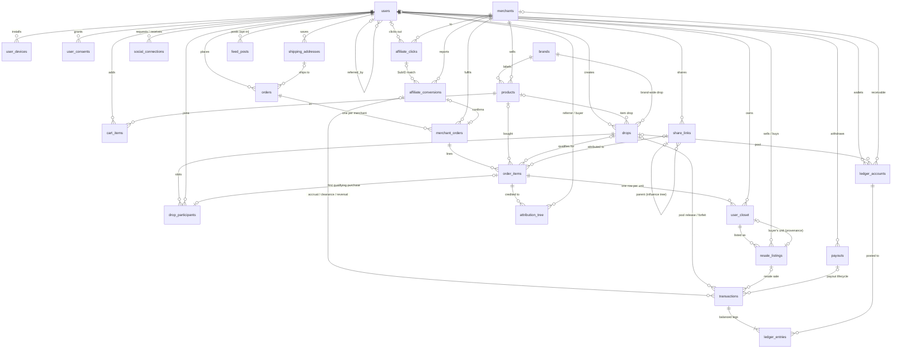
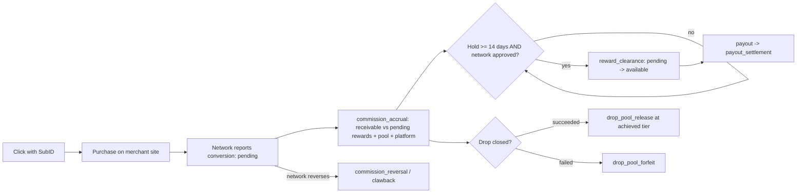
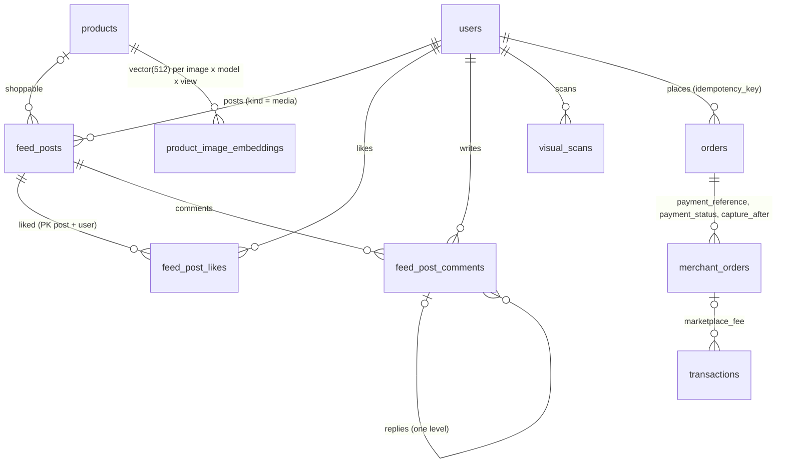

# Entity relationship diagram

Keys and relationships only; see `backend/database/sql/*.sql` for every column and constraint.
Renders in GitHub, Cursor's Markdown preview and any Mermaid viewer.

## Money flow for one affiliate purchase

## Release 2 additions (social discovery and 1-Tap)

New tables and the relationships they add; columns and triggers are in the `2026_10_12_*` migrations and
explained in `docs/ARCHITECTURE.md` section 4.

